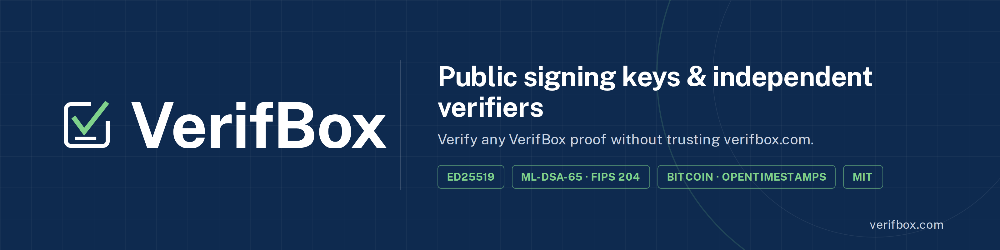
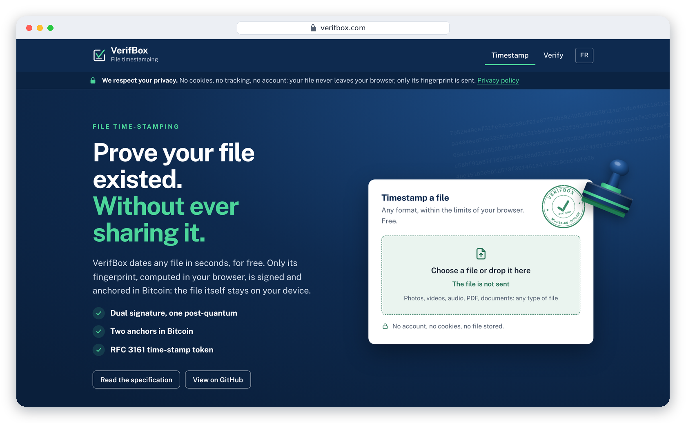
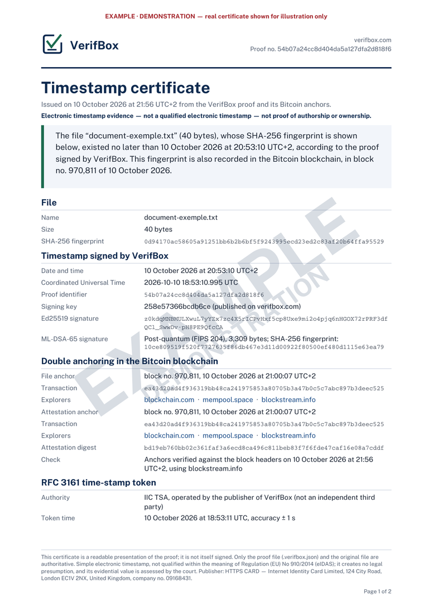
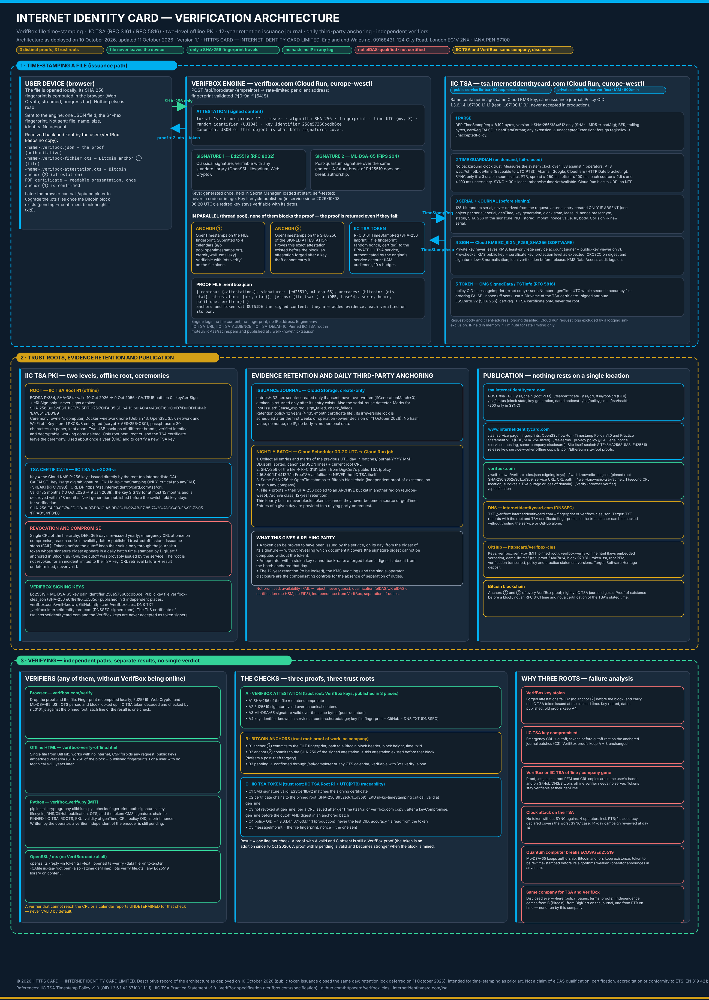
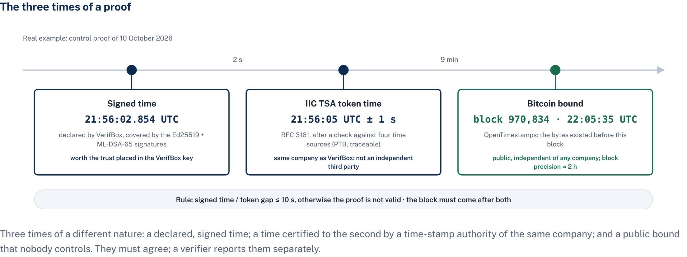
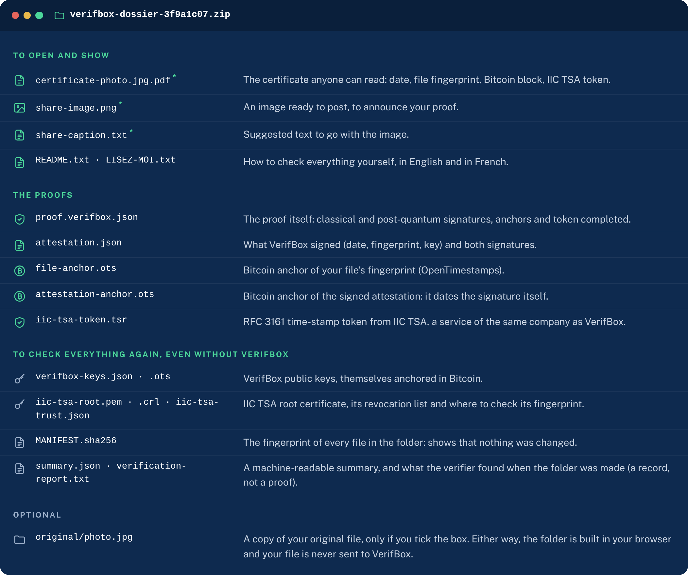

<p align="center">
  
</p>

<p align="center">
  <a href="https://verifbox.com">Website</a> ·
  <a href="https://verifbox.com/verify">Verify a proof</a> ·
  <a href="https://verifbox.com/specification">Specification</a> ·
  <a href="https://verifbox.com/fr">Français</a>
</p>

<p align="center">
  <a href="https://verifbox.com"></a>
  <br><sub><a href="https://verifbox.com">verifbox.com</a>: the file stays on your device, only its fingerprint is sent.</sub>
</p>

# VerifBox — public signing keys, verifiers and validation

This repository publishes the public signing keys of **VerifBox** (https://verifbox.com), a file timestamping service operated by HTTPS CARD — Internet Identity Card Limited (company no. 09168431, London).

It exists so that anyone can check the VerifBox key file **without trusting verifbox.com alone**: the same fingerprint is published here, in the DNS of internetidentitycard.com (DNSSEC-signed), and on verifbox.com. A substituted key file would not match all three.

## Legal status

> **Simple electronic timestamp, not qualified** within the meaning of Regulation (EU) No 910/2014 (eIDAS). A VerifBox proof **creates no legal presumption**: its evidential value is assessed by the court. IIC TSA, which issues the time-stamp token, is operated by the same company and is not an independent third party. The two Bitcoin anchors, for their part, depend on no company: they show that the file and the signed attestation existed no later than their block.
>
> *Horodatage électronique simple, non qualifié au sens du règlement (UE) n° 910/2014 (eIDAS). Une preuve VerifBox ne crée aucune présomption légale : sa valeur probante est appréciée par le juge. IIC TSA, qui émet le jeton d’horodatage, est exploité par la même société et n’est pas un tiers indépendant. Les deux ancrages Bitcoin, eux, ne dépendent d’aucune société : ils établissent que le fichier et l’attestation signée existaient au plus tard à la date de leur bloc.*

## What you get

<table>
<tr>
<td width="42%" valign="top">
<a href="https://verifbox.com/example-certificate-verifbox.pdf"></a>
<br><sub>Demonstration example based on a real proof of 10 October 2026, with the IIC TSA token, shown with an EXAMPLE watermark.</sub>
</td>
<td valign="top">
<p>Three files, each with its own role. You keep them: VerifBox keeps no copy.</p>
<p><strong>The proof</strong> <code>.verifbox.json</code><br>The authoritative document: the file’s fingerprint, the date and time, both signatures and the IIC TSA time-stamp token (RFC 3161). Issued immediately.</p>
<p><strong>The Bitcoin anchors</strong> <code>.ots</code><br>Two OpenTimestamps proofs, one for the file fingerprint and one for the signed attestation, recorded in the Bitcoin blockchain and verifiable without VerifBox. Completed within a few hours.</p>
<p><strong>The certificate</strong> <code>PDF</code><br>A readable presentation of everything, with links to the Bitcoin block and transaction, to attach to a file or send to an adviser. Available once the anchor is confirmed.</p>
<p><a href="https://verifbox.com/example-certificate-verifbox.pdf"><strong>View the example PDF →</strong></a></p>
</td>
</tr>
</table>

## Verification architecture, end to end

The complete architecture — browser, VerifBox engine, IIC TSA (time guardian, Cloud KMS key, issuance journal, nightly third-party anchoring), two-level PKI, publication points, and the checks every verifier performs — on one page. Version 1.1, state of 11 October 2026. Also as a [PDF](verifbox-architecture.pdf).

<p align="center"><a href="verifbox-architecture.png"></a></p>

## Public demonstration proofs

The [`demo-iic-tsa/`](demo-iic-tsa/) folder contains a real proof of 10 October 2026 with the double Bitcoin anchoring **and the IIC TSA time-stamp token** (proof `54b07a24…`, block 970,811), the original file, the `.ots` and `.tsr` files, the IIC TSA root certificate and the commands to replay every check, OpenSSL included. It is the proof behind the example certificate below. The [`demo/`](demo/) folder keeps an earlier proof of 5 October 2026, without token.

### The three times of a proof

A proof carries three times of a different nature: the signed time (VerifBox key), the IIC TSA token time (RFC 3161, same company), and the Bitcoin bound (public, nobody's). A verifier reports them separately and rejects a proof whose signed time and token time disagree by more than ten seconds.

<p align="center"></p>

## Reproducible validation

[`validation/VALIDATION.md`](validation/VALIDATION.md) holds two real production proofs with their files, the extracted `.ots` anchors and `.tsr` token, four negative vectors, the exact commands for each independent tool (Python verifier, OpenSSL, OpenTimestamps client, block explorers, browser) and the expected output of each, as recorded on 11 October 2026.

## Current key

| | |
|---|---|
| Key identifier | `258e57366bcdb6ce` |
| Status | active |
| In service since | 2026-10-03 06:20 UTC |
| Algorithms | Ed25519 (RFC 8032) + ML-DSA-65 (NIST FIPS 204) |
| SHA-256 of `verifbox-cles.json` | `e0f8ef8020965dca46c973a84d5d78ff52c9580c1c5979886bab2cb0f15c565d` |

## Check the key file

Each published version of `verifbox-cles.json` is also anchored in the Bitcoin blockchain with OpenTimestamps: `verifbox-cles.json.ots` (here and at https://verifbox.com/.well-known/verifbox-cles.json.ots). It proves that this exact key file existed before a given block, independently of this repository, of the DNS and of verifbox.com:

```bash
ots verify -f verifbox-cles.json verifbox-cles.json.ots
```

The current key file (`258e57366bcdb6ce`, SHA-256 `e0f8ef80…c565d`) is anchored in **Bitcoin block 970891** (11 October 2026, 08:36 UTC; merkle root `f7b5c1d9…aafe`), which `ots --no-bitcoin verify` names and any block explorer confirms. (The anchor of a freshly published key file is "pending" for a few hours, until its Bitcoin block exists; `ots upgrade verifbox-cles.json.ots` fetches the completed proof.)

```bash
curl -s https://verifbox.com/.well-known/verifbox-cles.json | shasum -a 256
dig +short TXT _verifbox.internetidentitycard.com
```

Both must show the fingerprint above, which must also match `verifbox-cles.json` in this repository.

## Verify a VerifBox proof

### Without any technical skill: the offline page

1. Download `verifbox-verify-offline.html` from this repository (button "Download raw file"). Its SHA-256 is `876bc3a95a224f8641abd340d1cc40ab9584c2d73c4f8173717fe553ba58a867` (version of 11 October 2026; earlier and later versions remain in the repository history and in the Software Heritage archive).
2. Double-click it: it opens in your browser, on Windows, Mac or Linux.
3. Drop the proof (`.verifbox.json`) and the original file.

The page works without any internet connection and cannot make any network request. The public key file is included in it **verbatim**, in the `<script type="application/json" id="cles-integrees">` block: the SHA-256 of the text between those two tags is exactly the fingerprint above. The page recomputes this fingerprint when it opens and shows it at the bottom, with a warning if it ever differed. Only the keys included in the page are trusted as roots: a key file loaded by hand can only add keys attested by a trusted key, or mark known keys as retired or revoked. It can never add a root key or lift a revocation. Such a file can therefore cause a proof to be refused, never to be accepted. The Bitcoin block number shown offline is read from the .ots file itself and is not verified against Bitcoin.

### In Python

```bash
pip install cryptography dilithium-py
python3 verifbox_verify.py proof.verifbox.json original-file --ots anchor.ots
```

The verifier (`verifbox_verify.py`, MIT licence) checks the file fingerprint, both signatures, the key lifecycle, the DNS publication and, when the proof carries one, the IIC TSA time-stamp token (signature, chain to the pinned IIC TSA root, time-stamping usage, revocation list). It never calls the VerifBox API: by default it downloads the static public key file from verifbox.com and cross-checks it against DNS; with `--keys` it uses a local copy, and with `--offline` it makes no network request at all. The VerifBox root key and the IIC TSA root certificate are pinned in the script by their SHA-256; the IIC TSA Root R1 certificate itself is also embedded, so that `--offline` checks the token with no extra file (since 15 October 2026; earlier versions needed `--iic-root`). Specification: https://verifbox.com/specification

### Proof folder for a third party

<p align="center"></p>

<sub>* Added by the Verify page on verifbox.com only when the original file has been checked against the proof (and the file’s Bitcoin anchor is confirmed). The command-line verifier does not add them. <code>original/</code> holds a copy of the original file only on request; the folder is built in the browser, so the file is never sent to VerifBox either way. Same view on https://verifbox.com, section “Your proof folder, file by file”.</sub>

```bash
python3 verifbox_verify.py proof.verifbox.json original-file --bundle proof-folder.zip
```

Gathers in one `.zip` everything needed to examine a proof without VerifBox: the proof, the signed attestation and its algorithms, both OpenTimestamps anchors, the IIC TSA token with its root, revocation list and policy, the public key file and its own anchor, a summary with UTC times and blocks, the verification report, a README with the commands, and `MANIFEST.sha256`. The folder adds no signature: each element proves itself. The original file is left out unless `--bundle-include-file` is given. The Verify page on verifbox.com produces the same folder in the browser (its single download button), with the PDF certificate and the image to share added. Specification, section 12; validation, section 2.8.

## IIC TSA time-stamp token

Each proof also carries an RFC 3161 time-stamp token over the file fingerprint, issued by **IIC TSA** (https://tsa.internetidentitycard.com/tsa). IIC TSA is operated by the same company as VerifBox and is not an independent third party; it is not an eIDAS-qualified trust service. Its root certificate (`IIC TSA Root R1`, SHA-256 `86:52:E3:D1:3E:72:5F:7C:75:7C:FA:05:3D:64:13:60:AC:A4:43:CF:6C:09:D7:D6:DD:D4:4B:EA:85:1E:D3:B9`) and the root revocation list are published at https://verifbox.com/.well-known/iic-tsa.json. To check a token with OpenSSL alone:

```bash
python3 verifbox_verify.py proof.verifbox.json original-file --tsr token.tsr
openssl ts -verify -data original-file -in token.tsr -CAfile iic-tsa-root.pem
```


## Independent archive

A permanent copy of this repository is kept by **Software Heritage** (Inria, with UNESCO support), so that the verifiers, the public key file and the validation vectors remain available even if GitHub, verifbox.com or the operator disappear. Archive: https://archive.softwareheritage.org/browse/origin/?origin_url=https://github.com/httpscard/verifbox-cles. Snapshot of 12 October 2026: `swh:1:snp:5e7efe41e66cb024cb33357088f0059ad4cbc375`. Later versions are archived on request after each update.

## Bundled cryptographic libraries

The offline page embeds the following libraries in **readable, unminified** form, each preceded by a `// node_modules/...` marker naming its source file, so that the code can be compared with the official npm packages (MIT licence, [noble](https://paulmillr.com/noble/) by Paul Miller):

| Package | Version | npm integrity |
|---|---|---|
| `@noble/post-quantum` (ML-DSA-65) | 0.7.1 | `sha512-+P9981IiAnVh+rmcubozzVwrEy3XsN/tMhTnvsjV9VDaYpOnNCqWqKo2FLWxbu92YHfjGIlE5XnW175UK+ln+Q==` |
| `@noble/curves` (Ed25519) | 2.4.0 | `sha512-P4/62zrgfH33CneE3Dn4WhJVA22YUU0eR51wKIan4NVRvwsA0YnPTwWGpNbpuacSujmSFLvyzpyuR30+fbq2Ew==` |
| `@noble/hashes` (SHA-256) | 2.4.0 | `sha512-X5XaVWZIBCT7HHZGm5I7ZQXDwLG+bGXuSrMQAW+7Zvl87h1kmc1ZB1VSRJcpUfoUrGQp4Fkoxm5kZ+Ms+aW+eA==` |

Revoked keys always fail in the offline page: without an internet connection, it cannot confirm that a Bitcoin anchor is really recorded in a block, so it cannot safely accept a proof signed by a revoked key. Use the Verify page of verifbox.com for that case.

## Key rotation

Keys are never deleted. On rotation, the old key signs the new one, the old key becomes `retiree`, and this repository, the DNS record and verifbox.com are updated together. The commit history of this repository is the public record of these changes.

---

# VerifBox — clés publiques de signature, vérificateurs et validation

Ce dépôt publie les clés publiques de signature de **VerifBox** (https://verifbox.com), service d’horodatage de fichiers édité par HTTPS CARD — Internet Identity Card Limited (société n° 09168431, Londres).

Il permet de contrôler le fichier de clés de VerifBox **sans faire confiance au seul verifbox.com** : la même empreinte est publiée ici, dans le DNS d’internetidentitycard.com (signé par DNSSEC) et sur verifbox.com. Un fichier de clés substitué ne correspondrait pas aux trois.

**Ce que vous obtenez** : la preuve (`.verifbox.json`), qui fait foi et contient, depuis le 10 octobre 2026, le jeton d’horodatage IIC TSA (RFC 3161, vérifiable avec OpenSSL et la racine publiée sur verifbox.com/.well-known/iic-tsa.json ; IIC TSA est exploité par la même société que VerifBox) ; les deux ancrages Bitcoin (`.ots`), vérifiables sans VerifBox ; et un certificat PDF lisible, disponible une fois l’ancrage confirmé ([exemple](https://verifbox.com/exemple-certificat-verifbox.pdf)).

Clé actuelle : `258e57366bcdb6ce`, active depuis le 3 octobre 2026 à 06:20 UTC. Empreinte SHA-256 du fichier `verifbox-cles.json` : `e0f8ef8020965dca46c973a84d5d78ff52c9580c1c5979886bab2cb0f15c565d`.

**Vérifier une preuve sans compétence technique** (seules les clés intégrées à la page servent de racines de confiance) : téléchargez `verifbox-verify-offline.html` depuis ce dépôt, ouvrez-le d’un double-clic dans votre navigateur (Windows, Mac ou Linux), puis déposez la preuve (`.verifbox.json`) et le fichier d’origine. La page fonctionne sans connexion internet et ne peut envoyer aucune donnée sur le réseau. Son interface existe en français.

**Dossier de preuve (.zip)** : la page Vérifier de verifbox.com, une fois l’ancrage Bitcoin confirmé, télécharge un seul fichier `.zip` contenant tout ce qu’il faut pour examiner la preuve sans VerifBox : le certificat PDF, l’image à partager et son texte (seulement si le fichier d’origine a été vérifié), le LISEZ-MOI, la preuve, l’attestation signée, les deux ancrages Bitcoin, le jeton IIC TSA, les clés publiques et leur ancrage, la racine IIC TSA et sa liste de révocation, `MANIFEST.sha256`, un résumé et le rapport de vérification ; une copie du fichier d’origine seulement si vous cochez la case (le dossier est créé dans votre navigateur : le fichier n’est jamais envoyé à VerifBox). Détail fichier par fichier : image ci-dessus (section *Proof folder for a third party*) ou https://verifbox.com/fr, section « Votre dossier de preuve, fichier par fichier ». En ligne de commande : `python3 verifbox_verify.py preuve.verifbox.json fichier --bundle dossier.zip` (sans certificat ni image).

**Archive indépendante** : une copie permanente de ce dépôt est conservée par Software Heritage (Inria, avec le soutien de l’UNESCO), pour que les vérificateurs, le fichier de clés et les vecteurs de validation restent disponibles même si GitHub, verifbox.com ou l’exploitant disparaissaient. Instantané du 12 octobre 2026 : `swh:1:snp:5e7efe41e66cb024cb33357088f0059ad4cbc375`.

Autres méthodes : voir ci-dessus, ou https://verifbox.com/fr/specification
